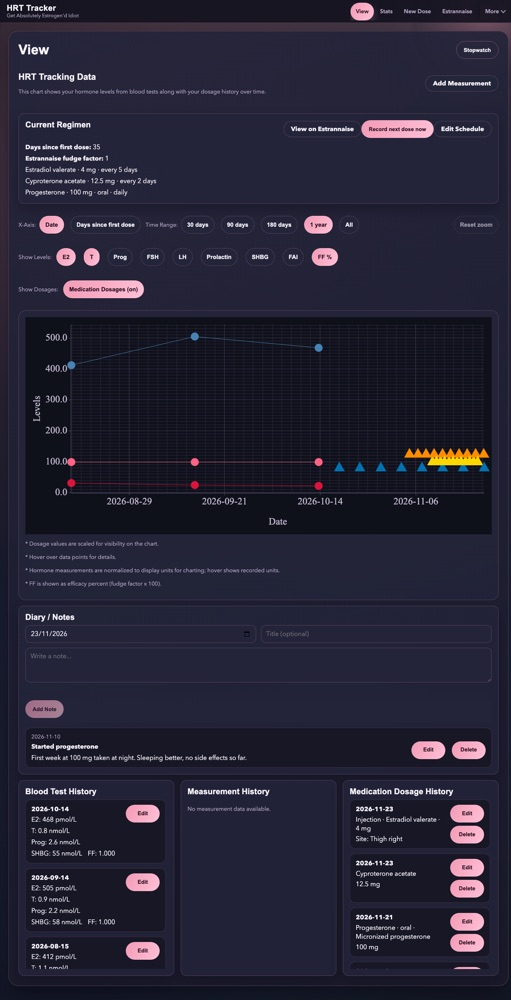
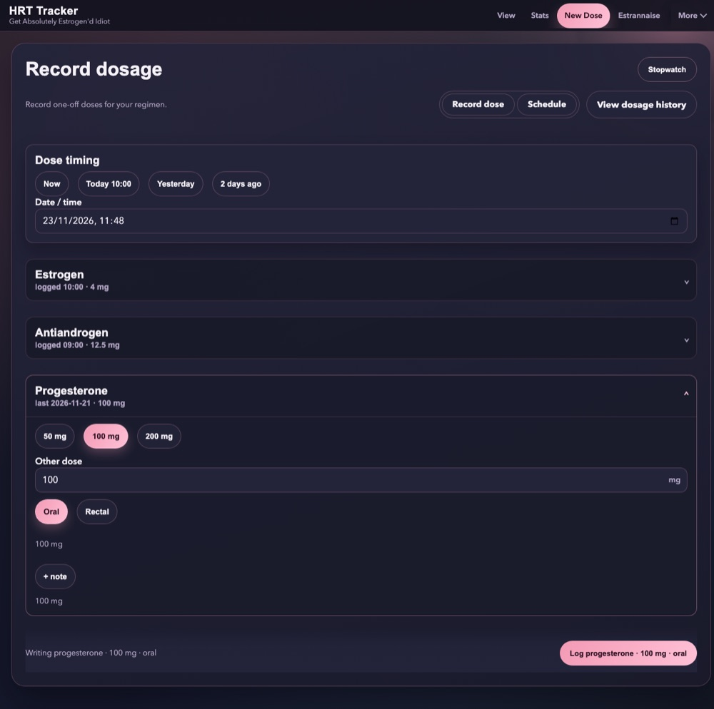
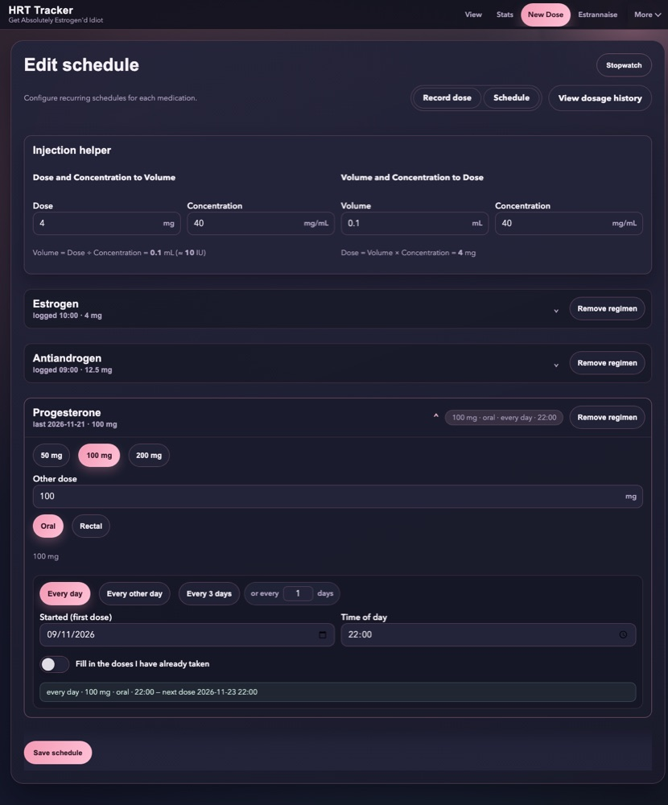
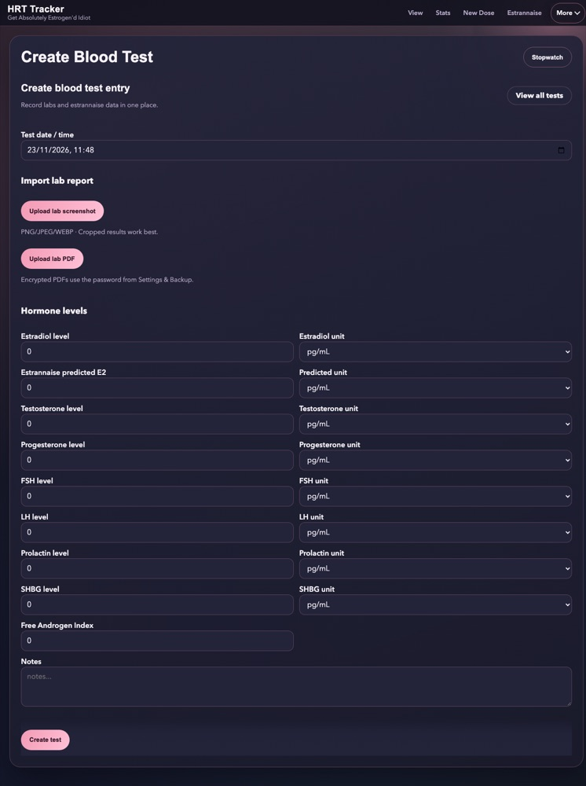
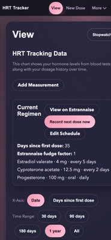

# HRT Tracker

A self-hosted web app for tracking hormone replacement therapy: doses and regimens, blood test results and body
measurements, charted against each other.



It runs on your own machine, and your data stays in a database file beside the app.

## What it does

- Record doses of injectable estradiol, oral estradiol, antiandrogens and progesterone, and keep a regimen for
  each with its own dose, interval, route and time of day.
- Log blood test results by hand, or import a lab report as a PDF or a screenshot and check the values it fills
  in.
- Chart estradiol, testosterone, progesterone, FSH, LH, prolactin, SHBG and free androgen index next to your
  dose history.
- Keep measurements and a diary of notes.
- Subscribe to doses and blood test reminders from a calendar app, if you want them.

## Requirements

- Rust, with the `wasm32-unknown-unknown` target added
- cargo-leptos
- wasm-bindgen-cli at the same version as the `wasm-bindgen` crate in `Cargo.lock`, because the two share an
  unstable format
- SQLite (the default) or a Postgres database

With Nix:

```sh
rustup target add wasm32-unknown-unknown
nix shell nixpkgs#cargo-leptos nixpkgs#dart-sass -c cargo leptos build
```

Without Nix, install the tools and pin wasm-bindgen to the lock file:

```sh
rustup target add wasm32-unknown-unknown
cargo binstall cargo-leptos
version="$(awk '/^name = "wasm-bindgen"$/{getline; gsub(/[^0-9.]/, ""); print; exit}' Cargo.lock)"
cargo binstall "wasm-bindgen-cli@$version" || cargo install wasm-bindgen-cli --version "$version"
cargo leptos build
```

## Running it

The app is two processes: `hrt-web` serves the interface and forwards API calls to `hrt-server`.

```sh
cargo run -p hrt-server   # API on 127.0.0.1:4200
cargo run -p hrt-web      # interface on 127.0.0.1:4100
```

Open <http://127.0.0.1:4100>. The first run creates the database and the directories it needs under `data/`.

Docker Compose builds both into one image and keeps `./data` on the host:

```sh
cp .env.example .env
docker compose up -d --build
```

There is no login. Run it on localhost, or put it behind a reverse proxy that adds authentication, and set
`HRT_ALLOWED_ORIGINS` to the address you serve it from.

## Configuration

Environment variables, as set in `.env.example`:

| Variable | Default | Effect |
| --- | --- | --- |
| `HRT_WEB_ADDR` | `127.0.0.1:4100` | Address the interface listens on |
| `HRT_SERVER_ADDR` | `127.0.0.1:4200` | Address the API listens on |
| `HRT_DATABASE_URL` | `sqlite://./data/hrt-data.db?mode=rwc` | Database to use, SQLite or `postgres://` |
| `HRT_ALLOWED_ORIGINS` | localhost origins | Origins allowed to call the API |

The rest is set in the app, under **Settings & Backup**. It covers auto backfill, blood test reminders and their
interval, display units, and injectable doses in IU or mg. The same page holds the password for encrypted lab
PDFs, the calendar feed secret, and the switch for progesterone in the feed.

## Recording a dose

The record page lists each medication as a row with the date and size of your last dose. Open the row for the
medication you took, set the dose, route and time, and press the button at the bottom of the screen. It writes
that one dose and leaves the other rows alone.



Every dose you record can be undone from the confirmation that appears at the bottom of the screen. The dashboard
also has a **Record next dose now** button, which logs whichever medication is due.

## Setting up a regimen

A regimen is a dose, an interval and a start date for one medication. In **Schedule**, press **+ Add progesterone
regimen** and the card opens set to the usual defaults: 100 mg, oral, every day at 22:00. Change what needs
changing, set the date of your first dose, and tick **Fill in the doses I have already taken** to add the doses
between then and today. The line under the controls shows what the schedule comes to, including the next dose.



The same card shape is used for estrogen and antiandrogens. The injection helper converts between dose,
concentration and the volume you draw, in mg and in IU.

## Blood tests

Enter results by hand or import a report. The import fills the form and nothing is saved until you press
**Create test**, so you can check every number first.



Two report layouts are read. The first puts one result per line: a label, then its value and unit. The second is
the banded layout from Randox Health, where each result sits above a row of Low, Optimal and High ranges. Screenshots of a report
work as well as PDFs; crop to the results table for the cleanest read. Encrypted PDFs use the password set in
Settings.

## Calendar feed

`GET /api/ics` returns your doses and blood test reminders as an iCalendar file, for any calendar app that can
subscribe to a URL.

- `?horizonDays=365` sets how far ahead scheduled doses are generated (default 365).
- `?includePast=0` drops the history and keeps only future doses.
- Set a secret under Settings to move the feed to `/api/ics/<secret>` and leave the public route returning 404.

Progesterone is left out of the feed unless you turn it on, because a daily tablet fills a calendar within a
year.

## Your data

Everything is stored under `data/`:

| Path | Contents |
| --- | --- |
| `hrt-data.db` | The database, when you use the default SQLite URL |
| `hrt-data.json` | The same data as JSON, kept alongside the database |
| `hrt-settings.yaml` | Settings |
| `dosage-photos/` | Photographs attached to injection doses |
| `bloodtest-pdfs/` | Uploaded lab reports |

**Export to JSON** on the Settings & Backup page writes a full copy you can keep elsewhere, and **Restore** reads
one back. Restoring overwrites the current data.

## Measurements, stats and the rest

Measurements record weight, height, chest, waist, hips and similar over time. The stats page breaks down your
history, the calculator converts doses and concentrations, and the vials page tracks what is left in a vial and
when it was opened. The Estrannaise link on the dashboard models an injectable regimen on
<https://estrannai.se>.

On a phone the layout collapses to one column:



## Development

```sh
cargo check -p hrt-web -p hrt-server -p hrt-shared
cargo test -p hrt-shared -p hrt-server -p hrt-web
```

The interface is Leptos compiled to WebAssembly; `cargo leptos build` produces `target/site`, which `hrt-web`
serves. OCR of uploaded screenshots runs in the browser, so no image leaves the machine.

## Limits

- One user, no authentication. Do not expose the port directly to the internet.
- The import recognises the layouts above. A report in another format fills what it can and leaves the rest for
  you to type.
- The calendar feed is read only.

## Licence

No licence file is included yet, which means all rights are reserved by default.
